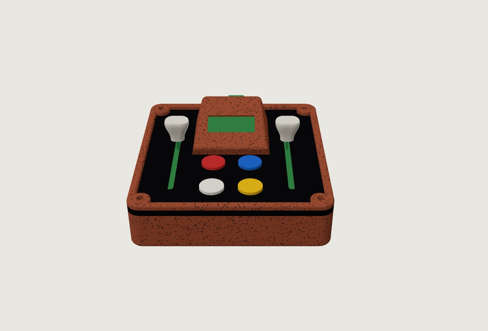

# Manual de uso · PULSAR

**Controlador físico con pantalla, luces, juegos y sintetizador web.**
Taller de Interfaces UAI · Luis-Felipe Benitez · 2026



---

## Índice

1. [Conoce tu PULSAR](#1-conoce-tu-pulsar)
2. [Encender](#2-encender)
3. [Controles básicos](#3-controles-básicos)
4. [Luces laterales](#4-luces-laterales)
5. [Pantalla y animaciones](#5-pantalla-y-animaciones)
6. [Combinaciones de botones](#6-combinaciones-de-botones)
7. [Juegos](#7-juegos)
8. [Sintetizador web](#8-sintetizador-web)
9. [Solución de problemas](#9-solución-de-problemas)
10. [Cuidados y mantenimiento](#10-cuidados-y-mantenimiento)
11. [Especificaciones](#11-especificaciones)
12. [Tarjeta rápida](#12-tarjeta-rápida)

---

## 1. Conoce tu PULSAR

| Parte | Dónde está | Para qué sirve |
|---|---|---|
| **Fader izquierdo** | costado izquierdo | control continuo; su tira de luz lo acompaña |
| **Fader derecho** | costado derecho | control continuo; su tira de luz lo acompaña |
| **Pantalla OLED** | arriba al centro, inclinada hacia ti | animaciones, juegos y avisos |
| **Botones rojo y azul** | fila de arriba | funciones según el modo; juntos cambian la animación |
| **Botones blanco y amarillo** | fila de abajo | el blanco cambia las luces; el amarillo, según el modo |
| **Luces laterales** | en las dos caras de los costados | muestran el nivel de cada fader |
| **Puerto USB-C** | cara trasera | energía y datos |

Arriba de cada fader hay una escala grabada en el acrílico. Abajo (hacia los botones) es 0 y arriba es 100.

---

## 2. Encender

1. Conecta un cable **USB-C con datos** al puerto trasero y al computador (o a un cargador, si solo vas a usar la caja sola).
2. La caja arranca sola en unos 4 segundos:
   - aparece el **galón** con el nombre **PULSAR**;
   - una cuenta regresiva **3 · 2 · 1** con las luces subiendo;
   - un **cohete despega** y las luces parpadean como fuego.
3. Queda en la animación **Cubo 3D** con las luces en **verde**.

> No necesita drivers ni instalación. Para apagarla, desconecta el cable.

---

## 3. Controles básicos

| Acción | Resultado |
|---|---|
| Subir un fader | su tira de luz se llena desde abajo, con un fundido suave entre luces |
| Apretar **blanco** | siguiente color o efecto de luces |
| Mover los faders con una animación | cambian su velocidad, tamaño o forma (ver sección 5) |

Las combinaciones (dos botones a la vez) están en la [sección 6](#6-combinaciones-de-botones). Para hacerlas, aprieta los dos botones casi al mismo tiempo.

---

## 4. Luces laterales

Cada pulsación del **blanco** pasa al siguiente modo. Después del último vuelve al primero.

| # | Modo | Cómo se ve |
|---|---|---|
| 1–9 | Colores fijos | verde, rojo, azul, cian, morado, amarillo, naranjo, rosado y blanco |
| 10 | Vúmetro | verde abajo que pasa a rojo arriba |
| 11 | Arcoíris | los colores giran; cada lado desfasado del otro |
| 12 | Respira | el color sube y baja de intensidad lentamente |
| 13 | Fuego | parpadeo naranjo |
| 14 | Láser | disparos rojos que suben hasta la posición del fader y destellan al llegar |

**Brillo:** azul + blanco alterna entre normal, bajo (para salas oscuras) y alto.

> El color de las luces también elige el **banco de funciones** del sintetizador web (sección 8).

---

## 5. Pantalla y animaciones

**Rojo + azul** pasa a la siguiente animación. Su nombre aparece arriba a la izquierda por un segundo y medio. Cuando suena música en el sintetizador web, todas laten con los graves.

| # | Animación | Fader derecho | Fader izquierdo |
|---|---|---|---|
| 1 | **Cubo 3D** · con un cubito interior que gira al revés | velocidad de giro | tamaño |
| 2 | **Hiperespacio** · estrellas en salto warp | velocidad | largo de la estela |
| 3 | **Cohete** · con fuego que titila | velocidad del viaje | mueve el cohete de lado a lado |
| 4 | **Planeta** · con anillo y una luna en órbita | velocidad de la luna | tamaño |
| 5 | **Al infinito** · cometa sobre el símbolo ∞ y el texto "¡Al infinito y más allá!" | velocidad | tamaño del ∞ |
| 6 | **Radar** · el comunicador de muñeca, con blips y "¿Zurg?" | velocidad del barrido | alcance |
| 7 | **Asteroides** · la nave dispara sola y suma puntos | velocidad de las rocas | mueve la nave |
| 8 | **Galaxia** · espiral de dos brazos | giro | tamaño |
| 9 | **Agujero negro** · partículas que caen en espiral | velocidad | tamaño |
| 10 | **Fugaces** · constelación que se une y estrellas fugaces | ritmo de la constelación | cantidad de fugaces |
| 11 | **Tierra** · globo que gira con un satélite | giro de la Tierra | velocidad del satélite |
| 12 | **Espectro** · barras del audio que suena en la web | — | — |
| 13 | **Túnel** | velocidad | giro |
| 14 | **Onda** | frecuencia | amplitud |
| 15 | **Octaedro 3D** | velocidad de giro | tamaño |

**Modo exhibición** (azul + amarillo): las animaciones cambian solas cada 10 segundos. Ideal para dejar la caja en una mesa.

---

## 6. Combinaciones de botones

| Combinación | Qué hace |
|---|---|
| **Rojo + azul** | siguiente animación |
| **Rojo + amarillo** | abre los **juegos** · otra vez: sale |
| **Azul + amarillo** | modo exhibición encendido / apagado |
| **Azul + blanco** | brillo de las luces: normal → bajo → alto |
| **Rojo + blanco** | **pulso a golpes**: tócalo 3 o 4 veces al ritmo que quieras y las luces y animaciones laten a ese pulso; la pantalla muestra los BPM. Mantenerlo 1,5 s lo apaga |
| **Amarillo + blanco** | pantalla de prueba (niveles de los faders, botón apretado y modo) |
| **Los 4 juntos** | **reinicio**: todo vuelve a como parte |
| **Los 4 juntos 3 segundos** | borra los récords de los juegos |

---

## 7. Juegos

**Rojo + amarillo** abre el menú **JUEGOS**.

| En el menú | |
|---|---|
| Blanco o azul | bajar |
| Rojo | subir |
| Amarillo | jugar |
| Rojo + amarillo | salir de los juegos |

Mientras juegas, los botones son del juego: el blanco no cambia las luces y la web no dispara audio con ellos.

**Récords:** la caja guarda el mejor nivel de **Simón**, el mejor puntaje de **Asteroides** y la mejor racha de **Alunizaje** en su memoria, así que no se pierden al desenchufarla. El menú muestra cada récord y aparece **NUEVO RECORD!** cuando lo superas. Para borrarlos, mantén los 4 botones juntos 3 segundos.

### Pong (2 jugadores)

- Cada fader mueve la paleta de su lado: subir el fader sube la paleta.
- La pelota se acelera con cada golpe; si le pegas con la punta de la paleta, sale en ángulo.
- Cuando alguien anota, se encienden en verde las luces de su lado.
- Gana el primero en llegar a **5**. Cualquier botón empieza otra partida.

### Simón dice

1. La caja muestra una secuencia de colores en las luces y su nombre en la pantalla.
2. Cuando aparece **TU TURNO**, repítela con los botones de color.
3. Cada ronda agrega un color más.
4. Si te equivocas aparece **PERDISTE** con tu nivel. Cualquier botón vuelve a empezar.

### Alunizaje

- **Fader derecho:** potencia del motor (frena la caída y gasta combustible).
- **Fader izquierdo:** inclina la nave hacia los lados (al medio, recto).
- Hay que posarse sobre la **plataforma** (la franja gruesa) despacio y derecho.
- Arriba a la izquierda está el combustible y arriba a la derecha la velocidad de caída.
- Luces verdes: ¡alunizaste! Rojas: te estrellaste. Cualquier botón vuelve a empezar.
- Arriba se ve tu **racha** de alunizajes seguidos y el récord.

### Asteroides (animación)

En la animación **Asteroides** la nave dispara sola y tú la mueves con el fader izquierdo. Si una roca la toca, el puntaje vuelve a cero; el mejor queda guardado como récord.

---

## 8. Sintetizador web

La caja se conecta a una página web que muestra todo en tiempo real y la convierte en un sintetizador: una canción que se transforma en vivo con los faders y los botones.

### Abrir y conectar

1. Abre el dashboard en **Google Chrome o Microsoft Edge** (Safari y Firefox no permiten conectarse por USB):
   - archivo local: `dashboard/index.html` de este repositorio, o
   - el sitio privado del autor (pide usuario y clave).
2. Aprieta **Conectar** y elige el puerto de la caja (en Windows, un **COM**; en Mac, **usbmodem**).
3. El estado cambia a **Conectado** y los paneles empiezan a moverse.

> Si no tienes la caja a mano, **Modo demo** simula los controles.

### Qué muestra la página

- **Pantalla de la caja:** la OLED copiada en grande, en vivo, con sus colores reales (franja amarilla y azul). **Pantalla completa** la deja sola en la pantalla, ideal para proyectarla en clases.
- **Récords** de los juegos, leídos de la caja.
- **Faders:** porcentaje y voltaje de cada uno.
- **Botones:** se iluminan al apretarlos y dicen qué hace cada uno en el banco activo.
- **Luces laterales:** imitan lo que hace la caja.
- **Audio en vivo:** canción, filtro, velocidad, eco, reverb y samples.
- **Historial:** gráfico de los últimos 10 segundos.
- **Datos seriales:** lo que manda la caja, en bruto.

### Cargar una canción

- Aprieta **Cargar MP3** o **arrastra** el archivo a la página. Suena en loop.
- La **barra de avance** sirve para saltar a cualquier parte.
- Cada canción cargada queda guardada en ese navegador como **selección rápida** (botón ▶). La **×** la quita.

### Los faders

| Fader | Efecto en la canción |
|---|---|
| Izquierdo | **frecuencia del filtro**: barrido de apagado/grave a abierto/brillante |
| Derecho | **velocidad**, como un tornamesa: de 0,5x (lento y grave) a 2x (rápido y agudo); al medio, normal |

### Bancos de funciones

El color de las luces (botón **blanco**) elige el banco. La página muestra el banco activo y lo que hace cada botón.

| Luz | Banco | Rojo | Azul | Amarillo |
|---|---|---|---|---|
| Verde | **Reproductor** | sample (mantener graba) | eco | play / pausa |
| Rojo | **DJ** | volver al inicio | repetir un pedacito (mantener) | freno de tornamesa (mantener) |
| Azul | **Filtros** | paso bajo | paso alto | banda |
| Cian | **Espacio** | eco | reverb | silencio (mantener) |
| Morado | **Sampler** | pad 1 | pad 2 | pad 3 |

Los colores siguientes (amarillo, naranjo, rosado, blanco y los efectos) repiten los bancos en el mismo orden.

### Cómo samplear

1. **Mantén** apretado el botón del pad (más de 0,3 s) mientras suena lo que quieres grabar.
2. **Suelta**: el sample queda guardado (hasta 8 s) y su forma de onda aparece en la página.
3. Un **toque corto** lo dispara encima de la canción, con el filtro, el eco, el reverb y la velocidad del momento.

**Con el micrófono:** aprieta **Usar micrófono** (el navegador pide permiso). Desde ese momento los pads también graban tu voz o lo que suene en la sala. El micrófono no sale por los parlantes, así que no se acopla.

### Controlador MIDI

La página puede reenviar la caja como un **controlador MIDI** a programas de música como Ableton Live, GarageBand o FL Studio.

| Control | Mensaje MIDI (canal 1) |
|---|---|
| Fader izquierdo | CC 20 (0–127) |
| Fader derecho | CC 21 (0–127) |
| Rojo · azul · blanco · amarillo | notas 36 · 37 · 38 · 39 (los primeros pads de un Drum Rack) |

1. Crea un puerto MIDI virtual:
   - **Windows:** instala **loopMIDI** y crea un puerto (por ejemplo "PULSAR").
   - **Mac:** abre **Configuración de Audio MIDI → Estudio MIDI**, doble clic en **Bus IAC** y marca **El dispositivo está conectado**.
2. En la página aprieta **Activar MIDI** y elige ese puerto en **Salida**.
3. En tu programa, activa ese puerto como entrada MIDI. En Ableton, usa **MIDI Map** para asignar los faders a cualquier perilla.

> La caja no aparece sola como dispositivo MIDI por USB: su chip (ESP32-C3) no lo permite. La página hace de puente, así que debe quedar abierta y conectada.

### La pantalla baila con la música

Con una canción sonando, la página le manda el espectro a la caja 25 veces por segundo: la animación **Espectro** muestra 16 barras y todas las demás laten con los graves.

---

## 9. Solución de problemas

| Problema | Solución |
|---|---|
| La página dice "Este navegador no tiene Web Serial" | Usa Chrome o Edge. En iPhone/iPad no es posible. |
| No aparece el puerto al apretar Conectar | Revisa que el cable USB-C sea **de datos** (los de solo carga no sirven). Prueba otro puerto del computador. |
| "El puerto está ocupado" | Hay otra pestaña o programa conectado a la caja. Ciérralo y vuelve a conectar. |
| No suena nada | Carga un MP3 y revisa que el estado diga **sonando** (amarillo en el banco Reproductor). Revisa el volumen del computador y que no esté activo el **silencio** (banco Espacio). |
| Los botones hacen cosas raras | **Los 4 juntos** reinician todo. Revisa si estás dentro de un juego (la pantalla lo muestra; rojo + amarillo sale). |
| Las luces encandilan | **Azul + blanco** hasta "BRILLO BAJO". |
| Ableton o GarageBand no reciben MIDI | Revisa que el puerto virtual exista (loopMIDI o Bus IAC), que esté elegido en **Salida** y activado como entrada en el programa. La página debe seguir abierta. |
| La pantalla de la caja no aparece en la web | Solo funciona con la caja **conectada** (no en modo demo). Desconecta y vuelve a conectar. |
| La pantalla quedó en la de prueba | **Amarillo + blanco** la cierra. |
| La animación cambia sola | Está el modo exhibición: **azul + amarillo** lo apaga. |

---

## 10. Cuidados y mantenimiento

- **USB:** el conector trasero es un alargador fijo. No tires del cable de lado; desconéctalo derecho.
- **Faders:** las perillas van a presión. Si una sale, vuelve a empujarla derecha sobre la palanca.
- **Limpieza:** paño seco o apenas húmedo. **No uses acetona ni alcohol sobre el acrílico**: lo empaña o lo agrieta.
- **Patas:** son de TPU, antideslizantes. Si una se despega, una gota de cianoacrilato en gel dentro de su rebaje.

**Abrir la caja:** saca los **4 tornillos M3 × 12** de las esquinas; salen el marco y el acrílico juntos. Adentro, la placa XIAO va montada sobre **headers**: se saca tirando derecho hacia arriba, sin desoldar nada.

**Actualizar el programa:** con [PlatformIO](https://platformio.org/), desde la carpeta `firmware/`:

```bash
pio run -t upload
```

---

## 11. Especificaciones

| | |
|---|---|
| Microcontrolador | Seeed XIAO ESP32-C3 |
| Controles | 2 faders deslizantes de 60 mm, 4 pulsadores de color |
| Pantalla | OLED 0,96" monocromática, 128 × 64 |
| Luces | 8 LED RGB direccionables (4 por lado) |
| Conexión | USB-C (energía + datos serie 115200 baudios, mensajes JSON) |
| MIDI | a través de la página (Web MIDI): 2 CC y 4 notas |
| Memoria | récords guardados en la flash del ESP32 |
| Alimentación | 5 V por USB |
| Carcasa | impresión 3D + acrílico negro 3 mm cortado y grabado con láser |
| Medidas | 92 × 97 mm de base |

---

## 12. Tarjeta rápida

| | |
|---|---|
| **Blanco** | color de las luces (y banco del sintetizador) |
| **Rojo + azul** | siguiente animación |
| **Rojo + amarillo** | juegos (blanco elige, amarillo juega) |
| **Azul + amarillo** | exhibición |
| **Azul + blanco** | brillo |
| **Rojo + blanco** | pulso a golpes (mantener = apagar) |
| **Amarillo + blanco** | pantalla de prueba |
| **Los 4** | reinicio |
