# PULSAR · Controlador físico

_Modelo CTRL-04L_

**Entrega 1 · Unidad 2: Interfaces Físicas** · Taller de Interfaces, Universidad Adolfo Ibáñez · 2026
Luis-Felipe Benitez

Controlador MIDI-style de escritorio: dos faders deslizantes, cuatro pulsadores, una pantalla OLED inclinada hacia el usuario y luces laterales NeoPixel, construido sobre un shield soldado a medida para una **Seeed XIAO ESP32-C3**. Se conecta por USB a un **dashboard web** que muestra en tiempo real el estado de cada control y usa el controlador para transformar una canción en vivo (filtro, velocidad, eco, reverb y sampler).

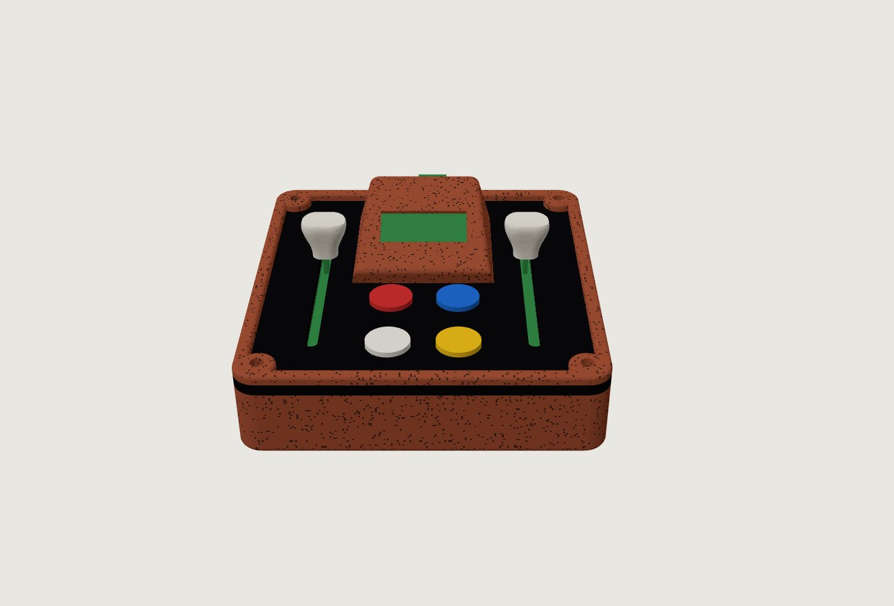

> 📘 **[Manual de uso](MANUAL.md)**: cómo usar cada control, las combinaciones, los juegos y el sintetizador web. También en [cuadernillo para imprimir](docs/manual_PULSAR_cuadernillo.pdf) (A4 a doble cara, doblado al medio) y en [PDF para pantalla](docs/manual_PULSAR.pdf).
>
> **Video de demostración:** _(pendiente: pegar aquí el enlace de YouTube)_

---

## Contenido

1. [Qué hace](#qué-hace)
2. [Hardware y shield](#hardware-y-shield)
3. [Esquemático](#esquemático)
4. [Carcasa y fabricación](#carcasa-y-fabricación)
5. [Firmware](#firmware)
6. [Dashboard web](#dashboard-web)
7. [Proceso de fabricación (fotos)](#proceso-de-fabricación)
8. [Estructura del repositorio](#estructura-del-repositorio)
9. [Cómo reproducirlo](#cómo-reproducirlo)

---

## Qué hace

| Control | Tipo de dato | En la caja | En el dashboard |
|---|---|---|---|
| Fader izquierdo | continuo (0–100 %) | llena su tira de luz lateral | frecuencia del filtro |
| Fader derecho | continuo (0–100 %) | llena su tira de luz lateral | velocidad de la canción (0,5x–2x) |
| Botón blanco | discreto | cambia el color/efecto de las luces | cambia el **banco** de funciones |
| Rojo · azul · amarillo | discreto | — | función según el banco activo |
| Rojo + azul | combinación | siguiente animación de la OLED | — |
| Amarillo + blanco | combinación | pantalla de prueba on/off | — |
| Rojo + amarillo | combinación | menú de **juegos** (y salir) | los botones quedan para el juego |
| Azul + amarillo | combinación | modo exhibición (cambia de animación cada 10 s) | — |
| Azul + blanco | combinación | brillo de las luces (normal / bajo / alto) | — |
| Rojo + blanco | combinación | pulso a golpes: tocarlo al ritmo fija el pulso; mantener 1,5 s lo apaga | — |
| Los 4 juntos | combinación | reinicio | — |

**Juegos** (rojo + amarillo abre el menú; blanco elige, amarillo empieza):

- **Pong** para dos jugadores: cada fader mueve una paleta; gana el primero en llegar a 5 y se iluminan las luces del lado que anota.
- **Simón dice:** la caja muestra una secuencia de colores en las luces y hay que repetirla con los cuatro botones de color, cada vez más larga.
- **Alunizaje:** el fader derecho es el motor y el izquierdo inclina la nave; hay que posarse suave sobre la plataforma antes de quedar sin combustible.

Al encender, la caja muestra el galón con el nombre PULSAR, una cuenta regresiva 3, 2, 1 con las luces subiendo y un cohete que despega.

**Bancos de funciones** (el color de las luces indica el banco):

| Luz | Banco | Rojo | Azul | Amarillo |
|---|---|---|---|---|
| Verde | Reproductor | sample (mantener graba) | eco | play / pausa |
| Rojo | DJ | volver al inicio | repetir (mantener) | freno de tornamesa (mantener) |
| Azul | Filtros | paso bajo | paso alto | banda |
| Cian | Espacio | eco | reverb | silencio (mantener) |
| Morado | Sampler | pad 1 | pad 2 | pad 3 |

Los colores siguientes repiten los bancos en el mismo orden.

**Animaciones de la OLED** (rojo + azul): cubo 3D, hiperespacio, cohete, planeta con anillo y luna, «al infinito y más allá» (cometa sobre el símbolo ∞), radar del comunicador de muñeca, asteroides (la nave dispara sola), galaxia espiral, agujero negro, estrellas fugaces con constelación, la Tierra con un satélite, espectro del audio, túnel, onda y octaedro 3D. Los faders controlan velocidad y tamaño; cuando suena música, laten con los graves que manda el dashboard.

**Modos de luz** (botón blanco): verde, rojo, azul, cian, morado, amarillo, naranjo, rosado, blanco, vúmetro, arcoíris, respira, fuego y láser (disparos que suben hasta la posición del fader). El nivel se desliza con inercia y el LED del borde se enciende a medias, para un fundido suave.

---

## Hardware y shield

| Componente | Detalle |
|---|---|
| Microcontrolador | Seeed Studio XIAO ESP32-C3 (USB-C nativo) |
| Shield | Placa perforada 7 × 9 cm (26 × 31 agujeros, paso 2,54 mm) |
| Faders | 2 potenciómetros deslizantes B10K, recorrido 60 mm |
| Botones | 4 pulsadores 12 × 12 mm con tapa de color |
| Pantalla | OLED 0,96" SSD1306, I2C (0x3C), 128 × 64 |
| Luces | Tira WS2812B de 8 LED (4 por lado) con resistencia de 330 Ω en datos |
| USB | Alargador rígido USB-C macho-hembra (26 mm) hasta la cara trasera |

**Modularidad:** la XIAO va montada sobre **headers hembra** soldados al shield, así que se saca y se pone sin desoldar nada. Todos los componentes (faders, pulsadores, resistencias y cableado) están soldados a la placa perforada; no hay protoboard.

**Pines**

| Pin XIAO | Conexión |
|---|---|
| D0 (GPIO2) | botón blanco → GND |
| D1 / A1 (GPIO3) | cursor del fader derecho |
| D2 / A2 (GPIO4) | cursor del fader izquierdo |
| D3 (GPIO5) | botón azul → GND |
| D4 / D5 | OLED SDA / SCL |
| D6 (GPIO21) | botón rojo → GND |
| D7 (GPIO20) | botón amarillo → GND |
| D10 (GPIO10) | datos de la tira WS2812B (330 Ω) |
| 3V3 / GND | faders, OLED |
| 5V / GND | tira de LED |

Los botones usan el pull-up interno (activos en LOW). Los faders se leen con `analogReadMilliVolts` (calibración de fábrica del ADC), promedio de 16 muestras y suavizado exponencial, para una lectura estable y sin ruido.

---

## Esquemático

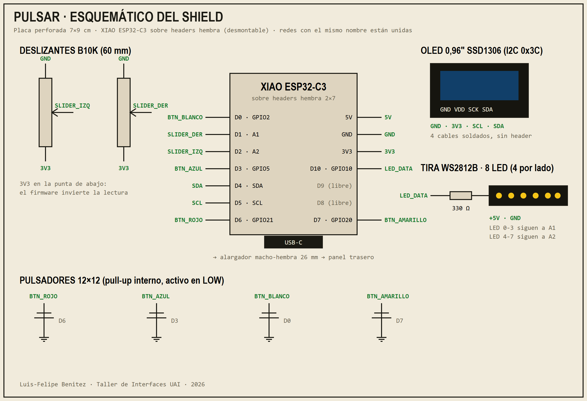

Versión vectorial: [`docs/esquematico.svg`](docs/esquematico.svg). Las redes con el mismo nombre están unidas.

---

## Carcasa y fabricación

La carcasa es **paramétrica** (Python + [build123d](https://github.com/gumyr/build123d)): todas las medidas salen de las fichas técnicas de los componentes y de mediciones sobre fotos de la placa real. El script revisa automáticamente que ninguna pieza choque con otra.

Tres capas, atornilladas con 4 tornillos M3 × 12 en las esquinas:

1. **Caja impresa en 3D:** aloja el shield sobre separadores con guías laterales, las tiras de LED tras ventanas laterales con láminas difusoras, y el paso del USB-C.
2. **Tapa de acrílico negro de 3 mm, cortada y grabada con láser:** ranuras de los faders, agujeros de los botones, paso de cables de la OLED y escalas grabadas junto a cada fader.
3. **Marco impreso** con la visera inclinada 15° que sostiene la OLED.

| Vista abierta | Vista lateral |
|---|---|
| 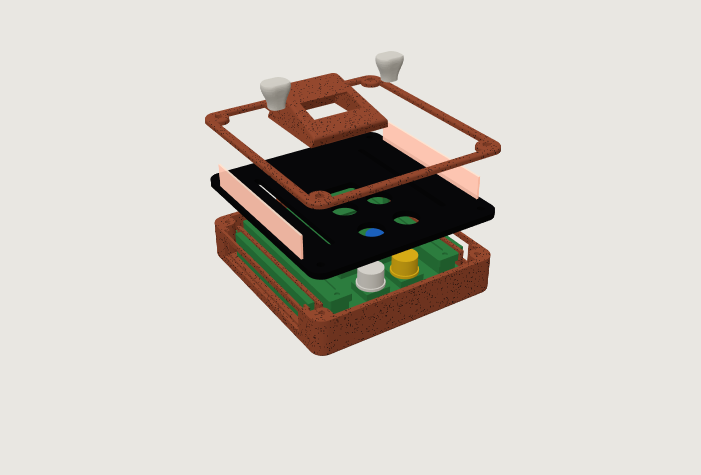 | 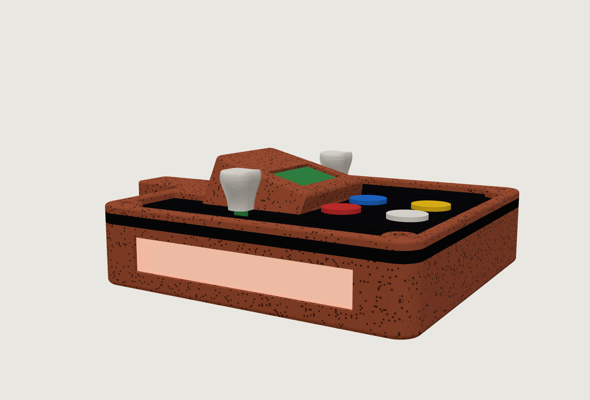 |

**Piezas** (`fabricacion/`):

| Archivo | Proceso | Notas |
|---|---|---|
| `CTRL-04L_1_caja` | impresión 3D | PLA/PETG |
| `CTRL-04L_3_marco_oled` | impresión 3D | de pie, soporte solo en el hueco de la OLED |
| `CTRL-04L_4_cuna_oled` | impresión 3D | cuña que empuja la OLED contra la visera |
| `CTRL-04L_5_lamina_difusora_x2` | impresión 3D | PETG/PLA blanco, 100 % relleno |
| `CTRL-04L_7_funda_usb` | impresión 3D | funda del alargador USB-C, boca abajo |
| `CTRL-04L_8_patas_tpu_x6` | impresión 3D | TPU (4 + 2 de repuesto) |
| `CTRL-04L_9_tapa_*` | impresión 3D a 2 colores | tapa protectora a presión, boca abajo, galón embutido |
| `perilla_H_ala_*` | impresión 3D a 2 colores | perilla "ala", cuerpo + galón embutido (AMS) |
| `CTRL-04L_acrilico_3mm` | corte láser | DXF/SVG: capa roja = corte, azul = grabado |

**Identidad visual:** **PULSAR**, una estrella que late con ritmo, como las luces, el pulso a golpes y el espectro del audio. Paleta verde limón + morado índigo, con perillas y animaciones inspiradas en la exploración espacial y en el imaginario de los juguetes espaciales (alas de jetpack, galones, cohetes).

**Tapa protectora:** encaja a presión sobre el marco y cubre la visera y las perillas; tiene un paso para el USB-C trasero y muescas para el pulgar.

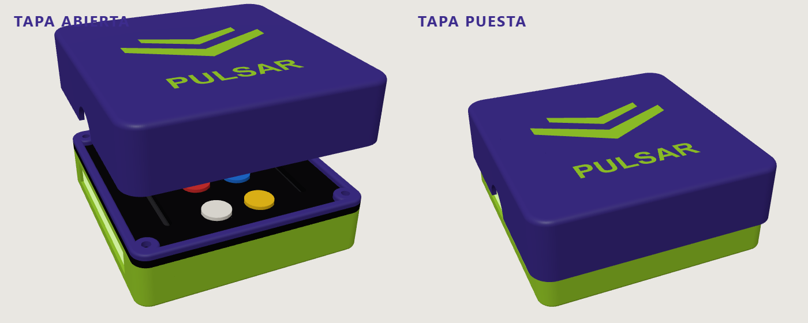

| Paleta de colores | Perillas |
|---|---|
| 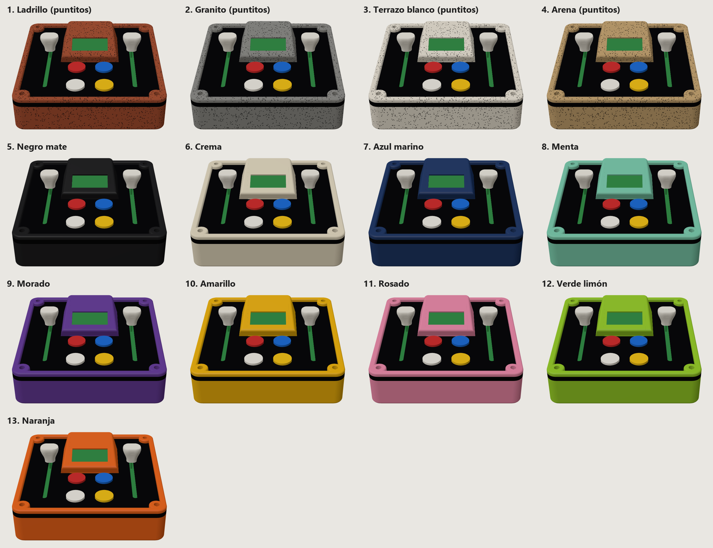 | 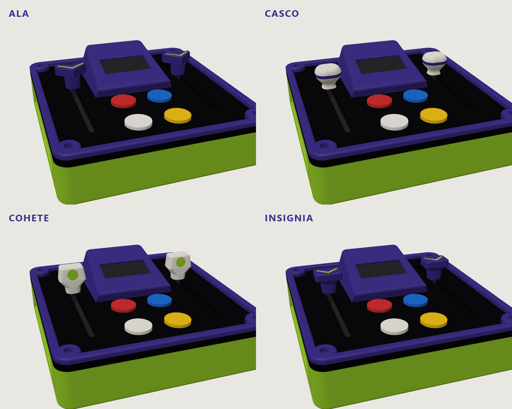 |

---

## Firmware

`firmware/` es un proyecto [PlatformIO](https://platformio.org/) (Arduino sobre ESP32-C3) con las librerías Adafruit NeoPixel y U8g2.

**Comunicación serial (115200 baudios).** Cada 50 ms la caja manda una línea JSON:

```json
{"izq":42,"der":87,"mv":[1650,380],"bot":[0,1,0,0],"modo":"VERDE","anim":"CUBO 3D"}
```

El dashboard le puede mandar líneas de vuelta:

| Línea | Efecto |
|---|---|
| `n` | siguiente modo de luces |
| `o1` / `o0` | espejo de la OLED: la caja manda `o` + los 1024 bytes de la pantalla en base64 (~10 por segundo) |
| `e` + 32 caracteres hex | espectro del audio (16 bandas, 0–255) que se dibuja en la OLED |

---

## Dashboard web

`dashboard/index.html` es una página sin dependencias externas (fuentes incluidas) que se conecta al controlador con **Web Serial** (Chrome o Edge).

- Faders con su valor y su voltaje, botones iluminados, simulación de las luces laterales, historial de 10 s y datos seriales en bruto.
- **Audio en vivo (Web Audio):** se carga un MP3 (botón o arrastrando el archivo) y el controlador lo transforma: filtro, velocidad tipo tornamesa, eco, reverb, freno, repetición y un sampler de 3 pads que graba lo que suena o el micrófono.
- Manda el espectro del audio a la OLED, 25 veces por segundo.
- **Modo demo** para mostrarlo sin el controlador conectado.

Para usarlo: abrir `dashboard/index.html` en Chrome o Edge → **Conectar** → elegir el puerto de la XIAO → **Cargar MP3**.

---

## Proceso de fabricación

| | |
|---|---|
| 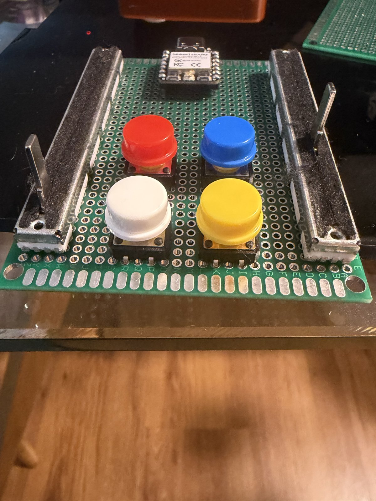 **1.** Shield con faders, pulsadores y la XIAO sobre sus headers. | 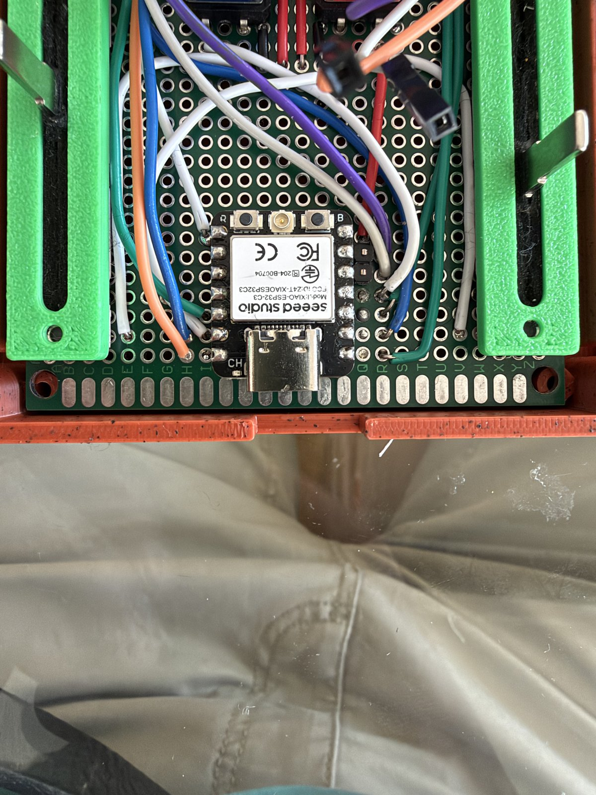 **2.** Cableado soldado del shield dentro de la caja. |
| 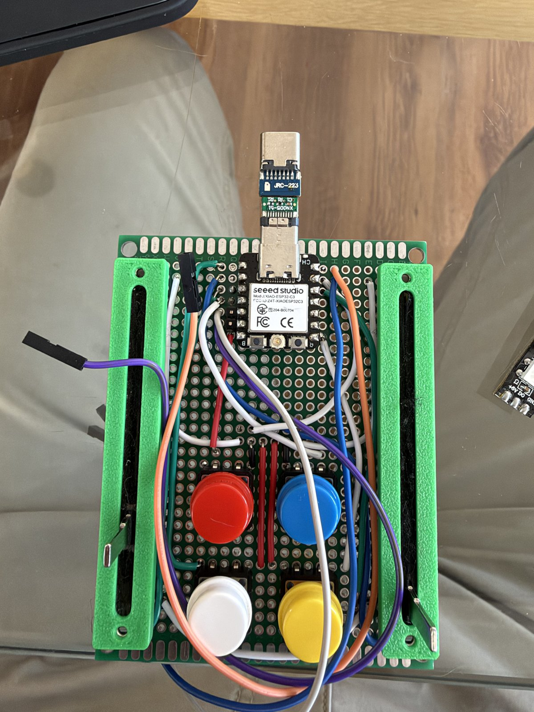 **3.** Shield montado con el alargador USB-C. | 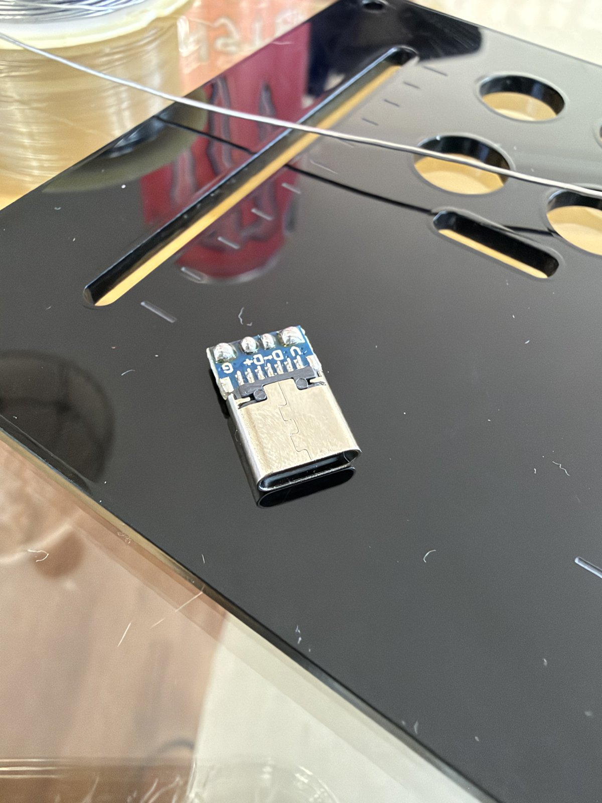 **4.** Conector USB-C hembra con datos, sobre la tapa de acrílico. |
| 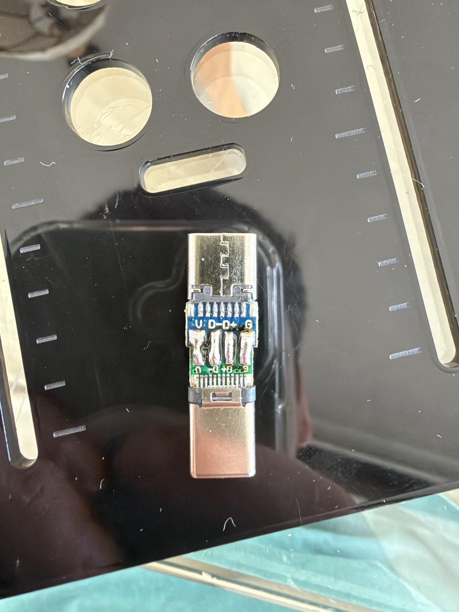 **5.** Alargador USB-C macho-hembra armado. | 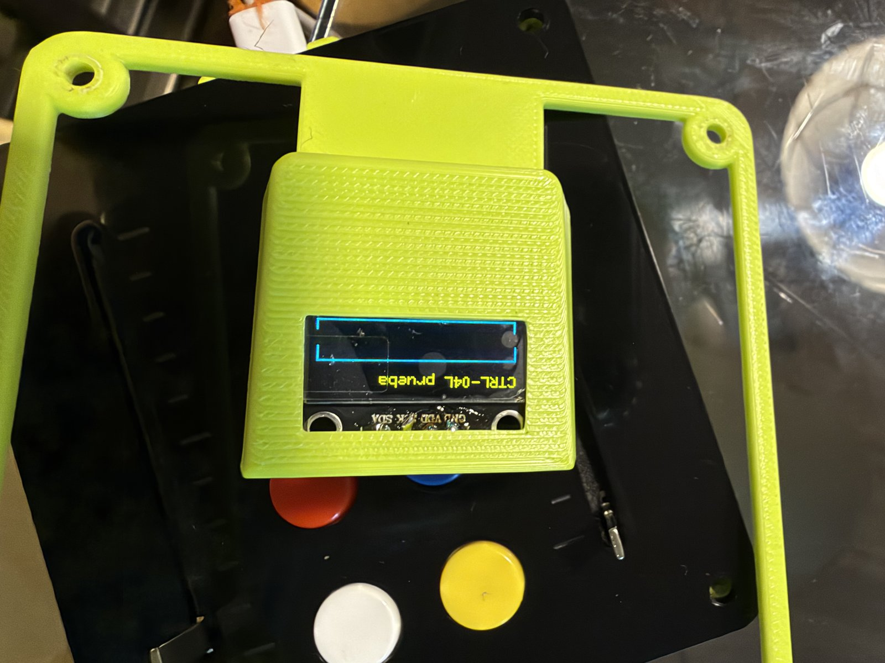 **6.** Prueba del marco con la OLED funcionando. |

---

## Estructura del repositorio

```
cad/            scripts paramétricos (build123d) de la carcasa, perillas y patas + renders
dashboard/      dashboard web (Web Serial + Web Audio)
docs/           esquemático, renders y fotos de proceso
fabricacion/    STL/STEP para impresión 3D y DXF/SVG para corte láser
firmware/       proyecto PlatformIO de la XIAO ESP32-C3
```

---

## Cómo reproducirlo

**Firmware**

```bash
cd firmware
pio run -t upload
```

**Carcasa** (Python 3.10+):

```bash
pip install build123d
python cad/caja_laser.py
```

Los archivos se generan en `salida_laser/`. `cad/perillas_buzz.py` y `cad/patas_tpu.py` generan las perillas y las patas.
